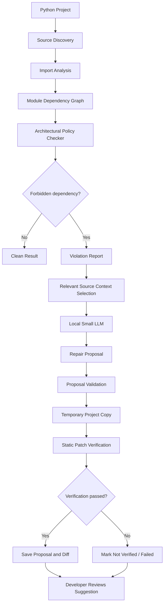

# TinyGuard

**Detect architectural violations. Get AI-assisted repair suggestions. Keep control of your code.**

TinyGuard is a lightweight Python architectural linter with an experimental local-LLM remediation workflow.

It analyzes Python projects, builds a module dependency graph, and detects when API modules depend on forbidden persistence-layer modules, either directly or through intermediate modules.

When a violation is found, TinyGuard can use a small locally running language model to **suggest a potential repair**. The proposed changes are checked by a static verifier in a temporary copy of the project and saved as a reviewable diff.

Your original source files are never automatically modified.

> **Status: Early prototype.** Detection is covered by automated tests and controlled benchmarks. AI-generated repairs are experimental: static verification checks structural compatibility, not behavioral equivalence.

## Why TinyGuard?

Consider a layered application:

```text
api.py
  └── logic.orders
        └── database
```

The API module does not import the database directly, but it still depends on the persistence layer through an intermediate module.

This creates architectural coupling that may violate the intended separation between API, business logic, and persistence.

TinyGuard detects this dependency chain and reports the path responsible for the violation.

But detection is only half the workflow.

Instead of leaving the developer with an error message, TinyGuard can pass relevant source context to a small local LLM and ask it to suggest a repair.

## Architecture



The architecture deliberately separates deterministic analysis from probabilistic repair suggestions:

- **Dependency analysis** determines whether a policy violation exists.
- **The local LLM** proposes a possible way to resolve it.
- **The static verifier** checks structural constraints on the proposed changes.
- **The developer** decides whether to accept and apply the proposal.

The LLM does not decide whether the original dependency violation exists.

## Quick start

Requires **Python 3.10 or later**.

```bash
git clone https://github.com/hyg356/TinyGuard.git
cd TinyGuard

python3 tinyguard.py /path/to/your/project
```

Example output:

```text
VIOLATION: api.py: forbidden dependency chain: api -> logic.orders -> database

TinyGuard failed: 1 violation(s) found.
```

### Exit codes

| Exit code | Meaning |
|---|---|
| `0` | Analysis completed; no forbidden dependency chain was found. |
| `1` | At least one forbidden dependency chain was found. |
| `2` | Usage or configuration error. |
| `3` | No API entry points were found. |
| `4` | Analysis error, such as a source file that could not be parsed. |

### Output formats

```bash
python3 tinyguard.py /path/to/project --format json
python3 tinyguard.py /path/to/project --format github
```

- `json` produces machine-readable results.
- `github` produces GitHub Actions-compatible error annotations.

## What TinyGuard detects

### API entry points

By default, TinyGuard recognizes API entry points using conventions such as:

- Files named `api.py`.
- Files inside an `api/` directory.
- Files inside `routes/`, `routers/`, `views/`, or `endpoints/` directories.

Directories such as `tests/`, `test/`, `docs/`, `examples/`, `build/`, and `dist/` are excluded from entry-point detection.

### Forbidden dependencies

The default policy includes:

- Dotted module components named `db` or `database`.
- Common database drivers and persistence libraries, including `sqlite3`, `aiosqlite`, `sqlalchemy`, `sqlmodel`, `peewee`, `psycopg`, `psycopg2`, `asyncpg`, `pymysql`, `MySQLdb`, `pyodbc`, `oracledb`, and `pymongo`.

Matching is component-based: `app.db` matches, while `db_utils` does not.

### Import analysis

TinyGuard handles:

- `import` and `from ... import` statements.
- Relative imports.
- Package `__init__.py` re-exports.
- Namespace packages.
- `src/` layouts.
- Ancestor package imports.
- Imports inside functions and `TYPE_CHECKING` blocks.
- BOM and PEP 263 source encodings.
- Constant-string calls to `importlib.import_module()` and `__import__()`.

Dynamic imports whose targets cannot be resolved statically are reported as warnings rather than silently treated as safe.

### Fail-closed behavior

A Python file that cannot be decoded or parsed is treated as an analysis error rather than silently skipped.

This avoids reporting a project as clean when TinyGuard could not fully inspect its source.

## AI-assisted repair suggestions

This is one of TinyGuard's defining features.

When TinyGuard detects a forbidden dependency chain, its experimental remediation workflow can use a locally running language model to suggest a potential architectural repair.

The workflow is designed to avoid sending the entire project indiscriminately to the model.

### How it works

1. **Violation detection:** The deterministic analyzer identifies the forbidden dependency chain.
2. **Context selection:** TinyGuard selects relevant files, including modules in the chain, ancestor packages, and nearby local imports, within a context budget.
3. **LLM proposal:** A local model receives the selected source context and the violation, then proposes a repair in a structured JSON format.
4. **Proposal validation:** TinyGuard validates the response, required fields, confidence information, and permitted file paths.
5. **Temporary patching:** Proposed changes are applied to a temporary copy of the project.
6. **Static verification:** The verifier checks whether the patched project satisfies structural requirements.
7. **Human review:** TinyGuard saves the proposal and diff for the developer to inspect.

### Run the local model

TinyGuard uses Ollama for its experimental local-model workflow. The default model is `qwen2.5:3b`.

```bash
ollama pull qwen2.5:3b
```

Start Ollama and use TinyGuard's proposal workflow:

```bash
python3 tinyguard.py /path/to/project --propose --out tinyguard-proposals
```

### What verification checks

The static verifier checks that the patched project:

- Parses and decodes successfully.
- Has no forbidden dependency chain from any detected API entry point.
- Retains the original public top-level functions, classes, and public methods.
- Does not replace meaningful function implementations with trivial stub bodies.
- Does not leave cross-module references to names that the patched module no longer binds.
- Does not introduce unresolved dynamic imports.

Proposals that fail verification are not marked as verified. Proposals with insufficient context, low confidence, or changes outside the supplied file set are withheld.

### Safety boundary

**TinyGuard suggests fixes; it does not automatically repair your project.**

- Original project files are never modified by the proposal workflow.
- Proposed changes are checked in a temporary copy.
- The resulting diff is saved for human review.
- The developer remains responsible for deciding whether to apply a proposal.

### What verification does not prove

Static verification does not establish behavioral equivalence.

A proposed patch may preserve function names and structural compatibility while changing actual program behavior. Such a patch could pass the current verifier.

The verifier may also reject legitimate refactorings, such as renaming or moving public symbols, because it cannot reliably distinguish intended refactoring from accidental breakage.

Every proposal must be reviewed and tested by a developer.

## Configuration

TinyGuard supports configuration through `tinyguard.toml` or the `[tool.tinyguard]` section of `pyproject.toml`.

Example:

```toml
[tool.tinyguard]
forbidden = ["db", "database", "redis_store"]

entrypoints = [
    "**/api.py",
    "**/api/**",
    "**/handlers/**"
]

non_application_dirs = ["tests", "docs"]

ignored_dirs = [
    ".git",
    ".venv",
    "venv",
    "__pycache__",
    "node_modules"
]
```

Configuration lists replace the corresponding defaults. Repeat any default entries that you want to retain.

Unknown configuration keys are errors, preventing misspelled settings from silently weakening the policy.

Patterns are glob-style and relative to the project root.

## Benchmarks and evaluation

TinyGuard has been evaluated through synthetic fixtures, a controlled comparison with Import Linter, and controlled injection experiments on a real FastAPI application.

| Evaluation | Result |
|---|---|
| Synthetic benchmark | 100/100 controlled fixtures passed |
| Head-to-head core corpus | TinyGuard: 24/24 correct classifications |
| Import Linter core corpus | 12/24 correct classifications |
| Constant-string dynamic import extensions | 2/2 detected |
| FastAPI controlled injections | 2/2 detected |
| Automated test suite | 29 passed |

### Synthetic benchmark

The synthetic benchmark contains 100 controlled fixtures across five categories:

- Direct imports.
- Transitive imports.
- Relative imports.
- Package re-exports.
- `src/` layouts.

TinyGuard passed all 100 fixtures, with no false positives or false negatives in this corpus.

### Head-to-head comparison

TinyGuard was compared with Import Linter 2.15 using a hand-authored 24-case core conformance corpus.

| Metric | TinyGuard | Import Linter |
|---|---:|---:|
| True positives | 12 | 12 |
| False positives | 0 | 12 |
| True negatives | 12 | 0 |
| False negatives | 0 | 0 |
| Precision | 100% | 50% |
| Recall | 100% | 100% |
| F1 | 100% | 66.67% |
| Accuracy | 100% | 50% |

Two additional constant-string dynamic import cases were tested as TinyGuard-specific extensions.

These results describe performance on this particular controlled corpus and policy. They do not establish that TinyGuard is generally superior to Import Linter.

### Real-world controlled injection tests

Two controlled violations were injected into a copy of `fastapi/full-stack-fastapi-template`:

- A direct API-to-database dependency.
- A transitive API-to-database dependency through an intermediate helper module.

TinyGuard detected both cases.

| Test | Result | Runtime |
|---|---|---:|
| Direct injection | PASS | 0.541 s |
| Transitive injection | PASS | 0.973 s |

The original cloned application was not modified.

This experiment tests detection of a specified policy in one real application's structure. It is not a broad production accuracy evaluation.

### Repository discovery

A separate discovery run attempted to analyze ten repositories.

| Classification | Count |
|---|---:|
| Clean | 2 |
| Violations | 0 |
| No recognized API entry points | 7 |
| Errors | 1 |

The Pydantic repository timed out after 180 seconds. Repositories without recognized API entry points were not evaluated for the intended API-to-persistence policy.

These discovery results are not a scored accuracy benchmark.

See [`benchmark/README.md`](benchmark/README.md) for methodology, detailed metrics, limitations, and reproduction commands.

## Testing

Install pytest:

```bash
pip install pytest
```

On Python 3.10, install `tomli` if configuration-file support requires it:

```bash
pip install tomli
```

Run the test suite:

```bash
python3 -m pytest -q
```

The current regression suite contains 29 passing tests. It covers graph traversal, CLI behavior, configuration, import resolution, proposal validation, patch verification, and end-to-end behavior.

Some remediation tests require a running local Ollama model and are skipped automatically when it is unavailable.

## Known limitations

- Only the shortest forbidden dependency chain is reported for each entry point.
- Detection is based on module names and configured policy.
- Unusual dynamic imports, computed import targets, `exec`, and `eval` may not be fully analyzable.
- Local variable names are not tracked with full semantic precision in every verifier check.
- The repair workflow cannot create or delete source files.
- Large repositories can take significant time to analyze.
- Real-world evaluation currently covers a limited number of suitable application architectures.
- AI repair quality has not yet been comprehensively evaluated.
- Static verification does not prove behavioral correctness.

## Roadmap

1. Expand real-world evaluation across applications with explicit architectural boundaries.
2. Improve performance on large Python repositories.
3. Add optional sandboxed execution and project-test verification for repair proposals.
4. Evaluate repair quality and behavioral regressions.
5. Report all reachable forbidden modules rather than only the shortest chain.
6. Improve dynamic import analysis and reduce false positives.
7. Add per-rule severity and exclusion controls.

## Related work

- [Import Linter](https://github.com/seddonym/import-linter) — enforces import contracts in Python projects.
- [Tach](https://github.com/gauge-sh/tach) — Python package architecture and dependency enforcement.
- [DCLfix](https://arxiv.org/abs/1506.07589) — research on recommending repairs for architectural violations.
- [SmellBench](https://arxiv.org/abs/2605.07001) — research on evaluating LLM agents for architectural smell repair.

TinyGuard does not claim novelty in architectural linting or automated repair as research areas. It explores how deterministic dependency analysis can supervise repair suggestions generated by a small local language model.

## Contributing

Issues and pull requests are welcome.

Useful contributions include:

- Minimal reproductions of incorrect dependency classifications.
- New import-resolution regression tests.
- Real-world repositories with clearly defined architectural policies.
- Performance improvements.
- Repair-verification edge cases.

## License

MIT. See [LICENSE](LICENSE).
